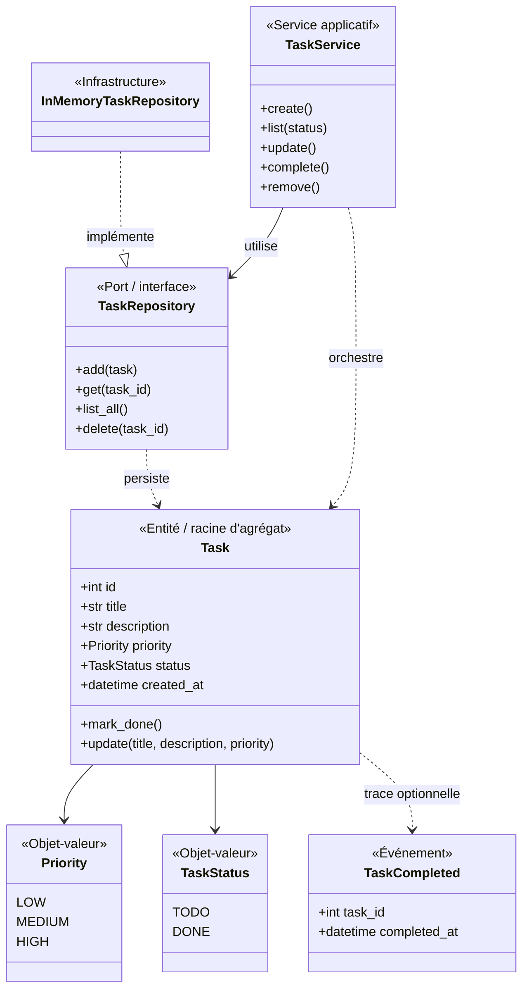

# Schéma du domaine — contexte « Gestion des tâches »

## Contexte borné
Un seul contexte : **Gestion des tâches**. Un contexte « Notifications » ou « Comptes » pourrait s'y ajouter plus tard.

## Éléments DDD

| Élément | Nom | Rôle |
|---|---|---|
| Agrégat (racine) | `Task` | Garantit les invariants : titre valide, terminer une seule fois |
| Objet-valeur | `Priority` | `basse`, `moyenne`, `élevée` ; immuable |
| Objet-valeur | `TaskStatus` | `todo`, `done` ; immuable |
| Port (interface) | `TaskRepository` | Accès aux tâches sans connaître le stockage |
| Service applicatif | `TaskService` | Orchestre les cas d'usage |
| Événement | `TaskCompleted` | Émis quand une tâche est terminée |

## Diagramme



## Règle de dépendance
Le **domaine ne dépend de rien** : ni FastAPI, ni infrastructure. Les autres couches dépendent de lui, jamais l'inverse.

```
API → Application → Domaine ← Infrastructure
```