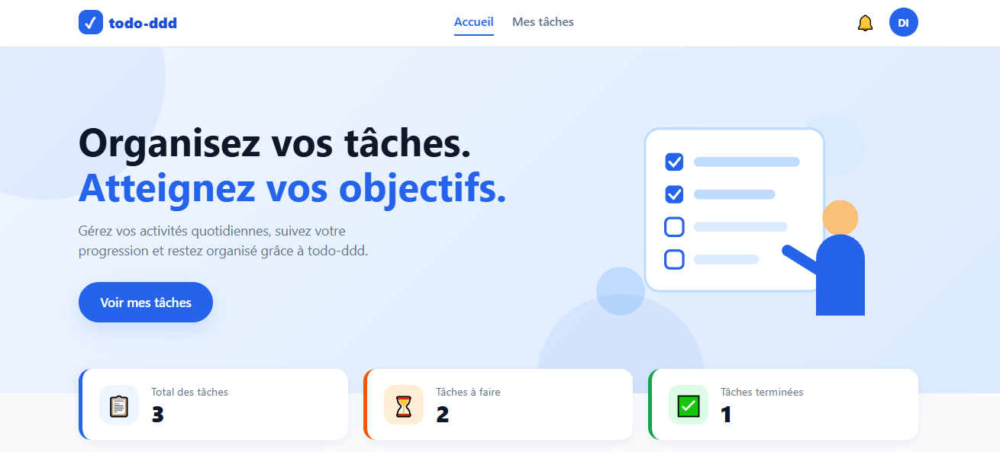
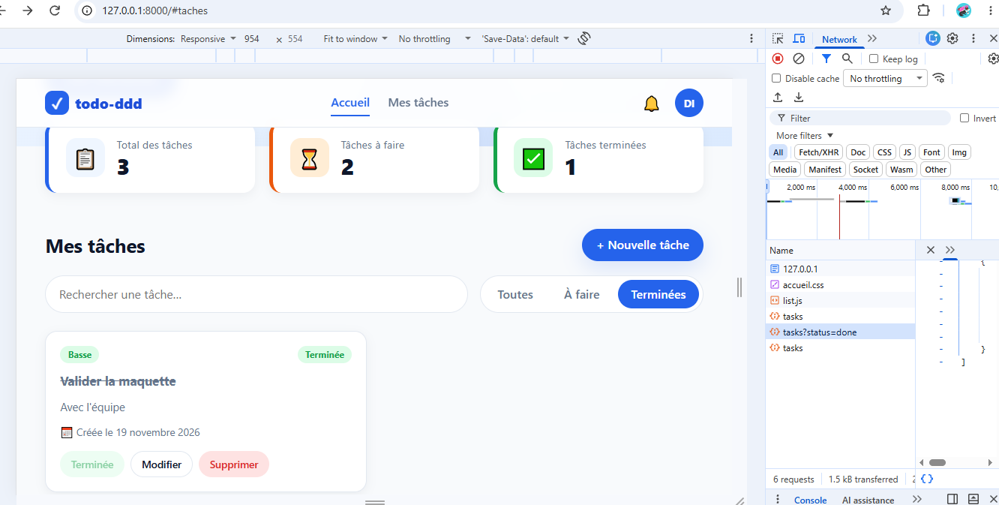
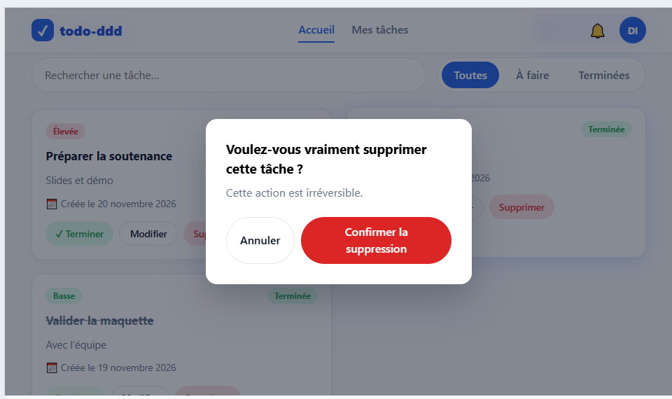
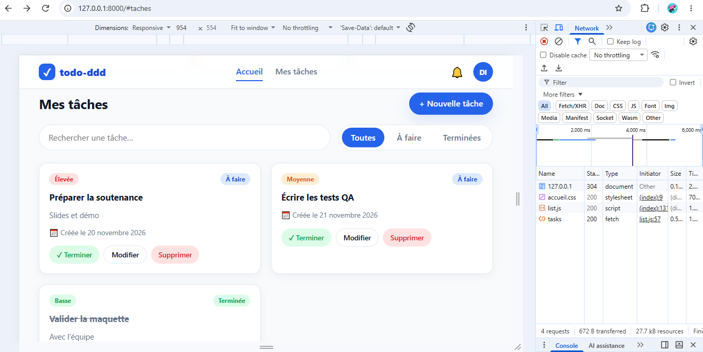
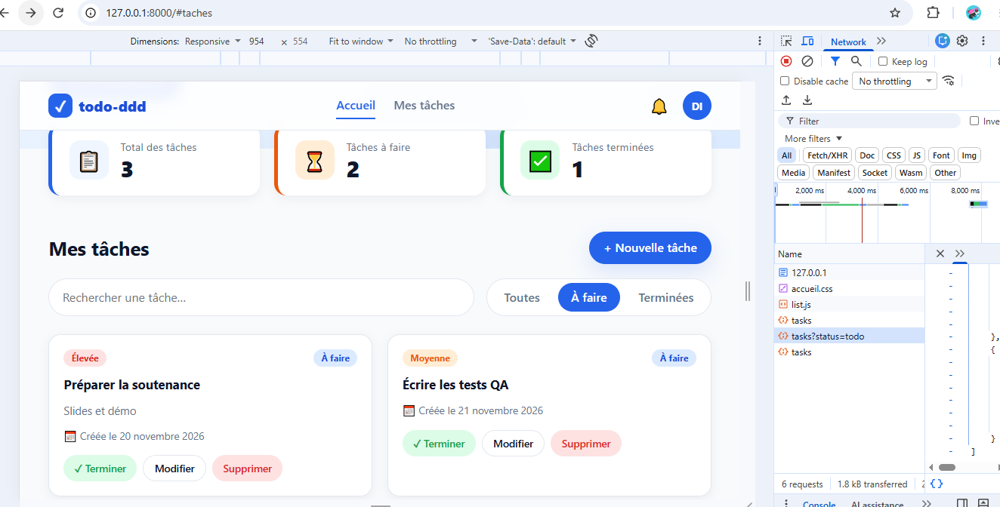
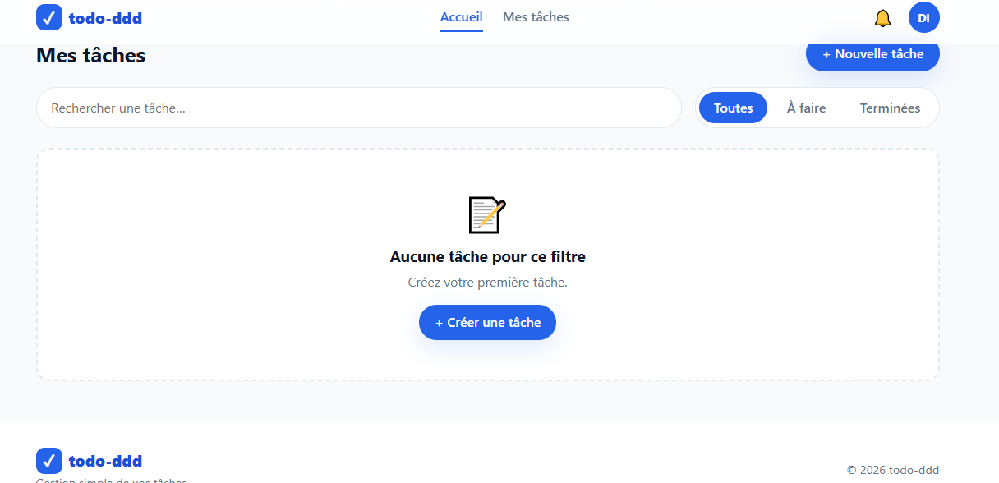

# Parcours manuels — Module M12 (Front-end liste / QA)

Relier ensuite chaque test aux parcours A, B, C du script de démo (M1) et joindre les captures dans `docs/preuves/captures-m12/`.

Pré-requis : serveur lancé (`uvicorn app.main:app --reload`), page ouverte sur http://localhost:8000, au moins 3 tâches (dont 1 terminée).
Colonnes « Résultat obtenu » et « Statut » à remplir pendant le test (✅ Réussi / ❌ Échec).

| ID | Objectif | Étapes | Résultat attendu | Résultat obtenu | Statut |
|----|----------|--------|------------------|-----------------|--------|
| T01 | Afficher toutes les tâches | Ouvrir la page | Une carte par tâche ; statistiques Total = À faire + Terminées | | |
| T02 | Recherche par titre | Taper un mot du titre d'une tâche | Seules les cartes correspondantes restent affichées | | |
| T03 | Recherche sans résultat | Taper « zzzzz » | Message « Aucun résultat » | | |
| T04 | Filtre Toutes | Cliquer « Toutes » | Toutes les tâches affichées | | |
| T05 | Filtre À faire (US-07) | Cliquer « À faire », ouvrir DevTools > Réseau | Requête `GET /tasks?status=todo` visible ; uniquement les tâches à faire ; statistiques inchangées | | |
| T06 | Filtre Terminées (US-07) | Cliquer « Terminées », DevTools > Réseau | Requête `GET /tasks?status=done` visible ; uniquement les tâches terminées ; statistiques inchangées | | |
| T07 | Terminer une tâche | Cliquer « Terminer » sur une tâche à faire | Badge « Terminée », bouton désactivé, notification de succès, statistiques mises à jour | | |
| T08 | Tâche déjà terminée (409) | Terminer une tâche déjà terminée côté serveur (via /docs puis cliquer) | Message « déjà terminée », carte mise à jour | | |
| T09 | Confirmation de suppression | Cliquer « Supprimer » | Modale « Voulez-vous vraiment supprimer cette tâche ? » ; rien n'est supprimé | | |
| T10 | Confirmer la suppression | Cliquer « Confirmer la suppression » | Carte retirée, notification de succès, statistiques mises à jour | | |
| T11 | Annuler la suppression | Cliquer « Supprimer » puis « Annuler » | Modale fermée, tâche toujours présente | | |
| T12 | Tâche introuvable (404) | Supprimer une tâche via /docs, puis la supprimer depuis la page | Message « introuvable », liste rechargée | | |
| T13 | Liste vide | Supprimer toutes les tâches | Message « Aucune tâche pour le moment » + bouton de création | | |
| T14 | Chargement | Ralentir le réseau (DevTools > Network > Slow 3G), recharger | Spinner « Chargement des tâches… » | | |
| T15 | Perte de connexion API | Arrêter le serveur, cliquer « Réessayer » | Message « Connexion impossible » ; après relance du serveur, « Réessayer » recharge la liste | | |
| T16 | Responsive ordinateur | Fenêtre > 1100 px | 3 statistiques en ligne, cartes en grille | | |
| T17 | Responsive tablette | DevTools, 768 px | Hero sur une colonne, statistiques empilées, cartes en 2 colonnes | | |
| T18 | Responsive mobile | DevTools, 375 px | Aucun défilement horizontal, filtres pleine largeur, boutons cliquables | | |
| T19 | 

Bouton Nouvelle tâche | Cliquer « + Nouvelle tâche » | Redirection vers la page de M11 | | |
| T20 | Bouton Voir mes tâches | Cliquer dans le hero | Défilement fluide vers « Mes tâches » | | |

## Captures des parcours A, B et C

### Parcours A : gestion des taches
Tests liés : T01, T07, T09, T10

### Parcours B : filtration
Tests liés : T04, T05, T06 (US-07)

### Parcours C : etats des taches
Tests liés : T09, T10, T11, T13

Closes #12
Le bouton « Nouvelle tâche » et le lien « Modifier » pointent vers form.html (valeur provisoire, constantes NEW_TASK_URL et EDIT_TASK_URL dans list.js). Ils fonctionneront quand la PR de M11 sera fusionnée. Test T19 en attente.